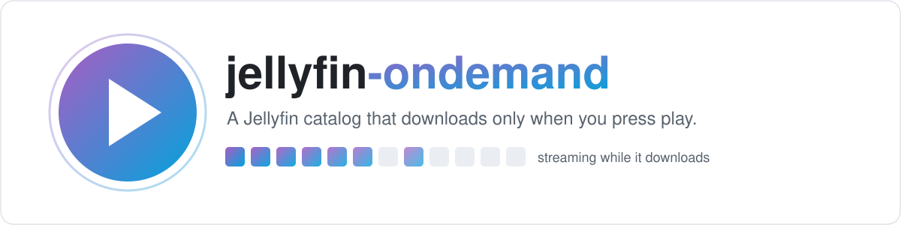
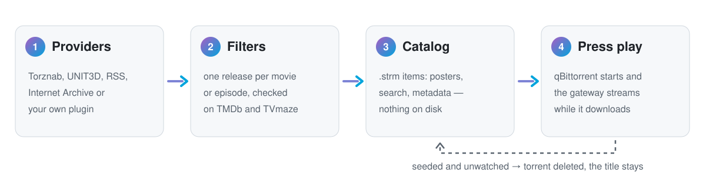

<p align="center">
  <picture>
    <source media="(prefers-color-scheme: dark)" srcset="docs/assets/banner-dark.svg">
    
  </picture>
</p>

<p align="center">
  <a href="https://github.com/NAbobo101/jellyfin-ondemand/actions/workflows/ci.yml"></a>
  <a href="LICENSE"></a>
  
  
  
</p>

<p align="center">
  <a href="README.md">English</a> · <b>Português (Brasil)</b>
</p>

---

**A biblioteca parece cheia. O disco continua vazio.** O jellyfin-ondemand enche o Jellyfin com filmes
e séries das fontes de torrent que **você** escolher. São itens de verdade, com pôster, metadados,
busca e "continuar assistindo", e nada é baixado até alguém dar play. Aí o torrent começa e o vídeo
toca **enquanto baixa**. Cumprida a regra de seed da fonte e sem ninguém assistindo, o torrent vai
embora e o título fica no catálogo, pronto para a próxima vez.

## Como funciona

<p align="center">
  <picture>
    <source media="(prefers-color-scheme: dark)" srcset="docs/assets/how-it-works-dark.svg">
    
  </picture>
</p>

1. **Os fornecedores** trazem as releases: um indexador pelo Prowlarr, a API de um tracker privado, um feed RSS, ou um plugin seu.
2. **Os filtros** escolhem uma release por versão de filme ou por episódio e conferem cada identidade no TMDb e no TVmaze.
3. **O catálogo** é uma pasta de arquivos `.strm` minúsculos dentro das suas bibliotecas do Jellyfin. Não ocupa espaço.
4. **No play**, o qBittorrent começa o torrent (sequencial, primeira e última peça antes) e um pequeno gateway entrega ao Jellyfin só as peças que já chegaram.

Os detalhes, e o porquê de cada peça, estão em [docs/architecture.md](docs/architecture.md) (em inglês).

## Destaques

<table>
<tr>
<td width="50%" valign="top">

### 🔌 Traga seus fornecedores
Adaptadores genéricos para **Torznab** (Prowlarr/Jackett: centenas de indexadores, sem programar),
trackers **UNIT3D**, **feeds RSS no qBittorrent** e o **Internet Archive**. Qualquer outra fonte vira um
plugin de umas 40 linhas de Python.

</td>
<td width="50%" valign="top">

### 🔎 Busca fora da biblioteca
Uma seção na própria página de busca do Jellyfin mostra o que você *ainda não* tem. Um toque adiciona
o filme e já toca; numa série, um toque traz todas as temporadas disponíveis.

</td>
</tr>
<tr>
<td valign="top">

### 📺 Séries bem montadas
Uma release por episódio, escolhida entre todas as fontes pela coerência da temporada, qualidade da
fonte, PROPER, pacote ou avulso e seeds. Só preenche os buracos das séries que você já tem.

</td>
<td valign="top">

### 🤝 Respeita trackers privados
O torrent privado nunca é abandonado pela metade. Cada fornecedor tem sua regra de seed
("72 h OU ratio 1.0") e seu filtro de freeleech. A passkey nunca vai para log, e só o qBittorrent baixa
o `.torrent`.

</td>
</tr>
<tr>
<td valign="top">

### ▶️ O play vem primeiro
A escrita do catálogo e o trabalho pesado esperam ninguém estar assistindo. Os outros downloads ficam
limitados enquanto um título do catálogo toca e ainda baixa.

</td>
<td valign="top">

### 💬 Legenda no seu idioma
A legenda no seu idioma é buscada no play e trocada sem reiniciar o vídeo. A página de busca fala
inglês e português, e acrescentar um idioma é preencher uma tabela.

</td>
</tr>
<tr>
<td valign="top">

### ✨ Extras para o jellyfin-web
Qualidade adaptativa com escadas HLS pré-geradas, pulo exato na timeline fora de casa (segmentos TS) e
troca de canal na TV ao vivo. Tudo opcional.

</td>
<td valign="top">

### 🪶 Roda num Celeron
Só a biblioteca padrão do Python: sem dependências, uns 20 MB de RAM e ~250 testes. Nasceu de uma
instalação que roda todo dia num pequeno servidor caseiro.

</td>
</tr>
</table>

## Por que não só Radarr/Sonarr?

Eles são ótimos para montar a biblioteca que você *guarda*. O jellyfin-ondemand é para tudo que você
*talvez* assista:

| | Baixar antes (*arr) | Baixar no play (ondemand) |
|---|---|---|
| Espaço em disco | todo título adicionado | só o que está tocando ou em seed |
| Tamanho do catálogo | limitado pelos seus discos | limitado pelas suas fontes |
| Seed | regras que você define e vigia | regra por fornecedor, depois limpeza automática |
| Primeiro play | instantâneo | alguns segundos enquanto o torrent parte |

E os dois convivem bem. Um torrent que já existe no seu qBittorrent é reaproveitado e nunca apagado, e
os episódios do catálogo só preenchem os buracos das séries que você guarda.

## Início rápido (Docker)

Você precisa do Docker com Compose. A stack de exemplo já traz Jellyfin 10.11, qBittorrent 4.6 e um
proxy reverso Caddy.

```bash
git clone https://github.com/NAbobo101/jellyfin-ondemand && cd jellyfin-ondemand
mkdir -p config data catalog downloads && touch catalog/.ondemand-marker
cp config.example.toml config/config.toml                 # fornecedores, idioma da legenda…
cp secrets.example.toml config/secrets.toml && chmod 600 config/secrets.toml
docker compose -f docker/compose.example.yml up -d --build
```

<details>
<summary><b>Depois, uma vez só, no Jellyfin (5 passos)</b></summary>

1. Crie uma chave de API (Painel → Chaves de API) e coloque-a em `config/secrets.toml`. Faça a WebUI do
   qBittorrent aceitar o container do ondemand: libere a sub-rede na whitelist, ou ponha usuário e senha
   nos segredos.
2. Adicione `/catalog/Movies` a uma biblioteca de Filmes, `/catalog/Movies 4K` a outra **separada** e
   `/catalog/Series` à de Séries. Desligue o **monitoramento em tempo real** dessas bibliotecas.
3. Em cada usuário, ligue **Forçar transcodificação de mídia remota** (os `.strm` exigem isso).
4. Instale o plugin [JavaScript Injector](https://github.com/n00bcodr/Jellyfin-JavaScript-Injector) e rode:
   ```bash
   JELLYFIN_URL=http://localhost:8096 JELLYFIN_API_KEY=… bash web/install-script.sh web/search.js "On demand: search"
   ```
   Os textos aparecem em português quando o Jellyfin está em português.
5. Veja o que os fornecedores colocariam no catálogo e importe:
   ```bash
   docker compose -f docker/compose.example.yml exec ondemand python3 -m ondemand.cli preview
   docker compose -f docker/compose.example.yml exec ondemand python3 -m ondemand.cli import
   ```

Depois confira tudo de uma vez: `docker compose -f docker/compose.example.yml run --rm ondemand python3 -m ondemand.cli doctor`
mostra uma linha por item e diz como corrigir o que falhar.

Já tem Jellyfin e qBittorrent rodando? Fique só com o serviço `ondemand`: [docs/jellyfin-setup.md](docs/jellyfin-setup.md).

</details>

> [!TIP]
> **Usa o [Claude Code](https://claude.com/claude-code)?** O repositório traz uma skill do projeto
> (`.claude/skills/jellyfin-ondemand`). Abra a pasta e peça para ele configurar tudo, adicionar o seu
> Prowlarr ou descobrir por que um título não toca: ele roda o `cli doctor` e corrige o que falhar.

A configuração de exemplo vem com um fornecedor, os filmes em domínio público do Internet Archive. Assim
dá para ver o fluxo inteiro funcionando antes de acrescentar os seus.

## Traga seus fornecedores

```toml
[[providers]]
name = "meu-indexador"
type = "torznab"                    # torznab | unit3d | qbit_rss | archive_org | python
url = "http://prowlarr:9696/1/api"
private = true
seed = { min_hours = 0, min_ratio = 1.0 }
# secrets.toml → [providers.meu-indexador] api_key = "…"
```

| Tipo | Para | Feed | Busca de filme | Busca de série |
|---|---|:-:|:-:|:-:|
| `torznab` | tudo que está no Prowlarr ou no Jackett | ✓ | ✓ | ✓ |
| `unit3d` | trackers privados com UNIT3D | ✓ | ✓ | ✓ |
| `qbit_rss` | feeds RSS lidos pelo qBittorrent (a passkey fica lá) | ✓ | acervo | acervo |
| `archive_org` | filmes em domínio público do Internet Archive | ✓ | ✓ | — |
| `python` | seu próprio plugin | você escolhe | você escolhe | você escolhe |

"Acervo": um feed sem busca tem os itens guardados a cada importação e consultados por nome depois.

Escrever um fornecedor é uma classe com até três métodos:

```python
from ondemand.providers import Provider, TorrentItem
from ondemand.providers.base import Http

class MeuSite(Provider):
    http = Http(pause=1.0)                # pedidos espaçados; erro nunca leva a URL

    def feed(self):                       # últimos uploads, para a importação periódica
        return [self.stamp(TorrentItem(title=r["name"], torrent_url=r["magnet"], seeds=r["seeders"]))
                for r in self.http.get_json(self.option("url") + "/latest")["results"]]

    def search_movie(self, query): ...    # opcional: query.imdb, query.title, query.year
    def search_series(self, query): ...   # opcional: query.name, query.tvdb, query.seasons
```

Interpretar o nome, identificar, filtrar, tocar e cuidar do seed é igual para todo fornecedor. O guia
completo, com um exemplo testado, está em [docs/writing-a-provider.md](docs/writing-a-provider.md) (em inglês).

## Documentação (em inglês)

| | |
|---|---|
| [Arquitetura](docs/architecture.md) | as peças e os comportamentos do Jellyfin e do qBittorrent de que dependem |
| [Escrever um fornecedor](docs/writing-a-provider.md) | a interface de fornecedor, passo a passo |
| [Configurar o Jellyfin](docs/jellyfin-setup.md) | caminhos, rede, bibliotecas, usuários, proxy reverso |
| [ABR e TS](docs/abr.md) | opcional: escadas de qualidade adaptativa, pulo exato fora de casa |
| [FAQ](docs/faq.md) | solução de problemas |
| [Zapping na TV ao vivo](web/extras/README.md) | opcional: troca de canal no IPTV |

## Próximos passos

- qBittorrent 5 (a API da WebUI trocou pause/resume)
- Mais idiomas nos textos da web e nas legendas
- Tirar do catálogo, depois de um tempo configurável, o título que nunca foi assistido
- Mais fornecedores genéricos embutidos (protocolos e softwares, nunca sites específicos)

Ideias e pull requests são bem-vindos. Comece pelo [CONTRIBUTING.md](CONTRIBUTING.md).

> [!IMPORTANT]
> **O projeto não traz nenhuma fonte de conteúdo.** Quem escolhe os fornecedores é você, e cabe a você
> cumprir a lei e as regras de cada fonte. Veja o [DISCLAIMER.md](DISCLAIMER.md).

## Licença

[GPL-3.0](LICENSE). Achou um problema de segurança? Veja o [SECURITY.md](SECURITY.md).
